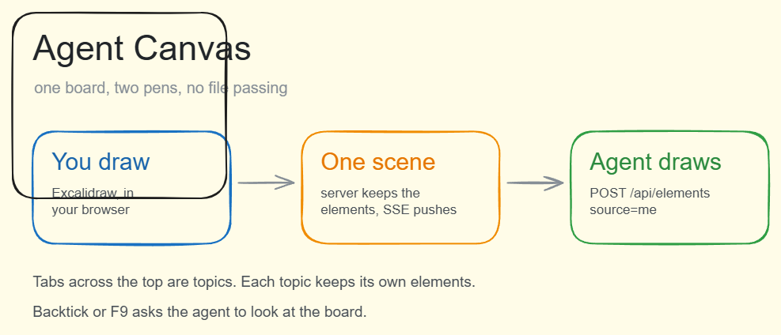

# Agent Canvas

A whiteboard you and an LLM agent draw on **together** — not by passing images back and forth, but by writing into the same list of elements on the same local server.

You sketch in [Excalidraw](https://excalidraw.com) in the browser. The agent reads those strokes over HTTP and drops its own shapes onto the same board, live, without you refreshing anything.



```
  your browser  ──POST /api/elements──▶  server.mjs  ──SSE──▶  your browser
       ▲                                     │
       └────── the agent's pen (draw.mjs) ───┘
```

## Why this exists

Most "AI + canvas" tools hand the model a screenshot, get a PNG back, and paste it on top. The result is a picture the model can't edit and you can't touch.

Here the agent works on the same `elements` array Excalidraw itself uses. It can add a box next to your arrow, label your diagram, or leave an answer beside your question — and afterwards you can drag, recolour and delete its work like anything else you drew.

Tabs across the top are **topics**: each tab is its own scene, so a board can hold several conversations.

## Quick start

```bash
pnpm install
pnpm build
pnpm start            # http://127.0.0.1:7801
```

Node 20+. No database — the scene lives in `scene.json` next to the server.

## Letting an agent draw

Write a JSON array of shapes, then push it:

```bash
node draw.mjs examples/demo.json
```

```json
[
  { "kind": "rect", "x": 60, "y": 170, "w": 250, "h": 130, "color": "#4dabf7" },
  { "kind": "text", "x": 84, "y": 200, "text": "You draw", "size": 30, "color": "#e7f5ff" },
  { "kind": "arrow", "points": [[320, 235], [390, 235]], "color": "#adb5bd" }
]
```

Shapes: `rect` · `ellipse` · `diamond` · `line` · `arrow` · `text`. Full list of fields is at the top of [`draw.mjs`](draw.mjs).

An agent with no script can just do it in two requests:

```bash
curl http://127.0.0.1:7801/api/elements            # what's on the board right now
curl -X POST "http://127.0.0.1:7801/api/elements?source=me" \
  -H 'content-type: application/json' \
  -d '{"elements":[ ...raw excalidraw elements... ]}'
```

`source=me` **appends** — it never wipes what the human drew. A plain `POST /api/elements` **replaces** the scene and is meant for the page itself.

## Environment

| variable | default | meaning |
| --- | --- | --- |
| `CANVAS_PORT` | `7801` | port to listen on |
| `CANVAS_AGENT_NAME` | `AI` | the name shown in toasts ("AI just drew a line") |
| `CANVAS_PING_URL` | *(unset)* | optional hook: pressing `` ` `` or F9 POSTs `{"text":"check"}` here, so your agent wakes up and looks at the board |
| `CANVAS_URL` | `http://127.0.0.1:7801` | where `draw.mjs` sends shapes |

## API

| method | path | does |
| --- | --- | --- |
| GET | `/api/config` | agent name, whether the ping hook is configured |
| GET | `/api/elements` | all elements of the current topic |
| POST | `/api/elements` | replace the current topic (the page uses this) |
| POST | `/api/elements?source=me` | append only — the agent's door |
| POST | `/api/replace` | replace + broadcast, optional `tombstone` list |
| GET | `/api/boards` | topic list + current id (`?full=1` includes elements) |
| POST | `/api/boards` | new topic `{name}` |
| POST | `/api/boards/select` | switch topic `{id}` |
| POST | `/api/boards/rename` | rename `{id,name}` |
| POST | `/api/boards/delete` | delete `{id}` (the last one is protected) |
| POST | `/api/ping` | fire the wake-up hook |
| POST | `/api/snapshot` | the page uploads a PNG of the board here → `latest.png` |
| GET | `/events` | SSE stream: `scene` and `boards` messages |

`/api/elements` and `/api/replace` only touch the **current** topic. Read `GET /api/boards` first if you're not sure which one that is.

## Notes from building it

- The page only knows how to **add**, so a scene deleted on the server used to be pushed straight back by the browser. Fixed with a `tombstone` set of deleted ids that both sides filter on.
- Element `type` must be `rectangle`, not `rect`. Get it wrong and Excalidraw draws nothing at all.
- Text does not wrap. You have to insert newlines yourself, and the element's `width` should be set or the bounding box lies.
- Dark strokes on a dark board are invisible. Check the board colour before picking a pen colour.
- The agent is turn-based: it looks at the board when you call it, not continuously.

## 中文

一块能一起画的布。你在浏览器里画，agent 通过 HTTP 接口往同一份元素数据上落笔——不是互传文件，是同一份数据。你画的东西它看得见、能接着往上加，它画的你也能拖、能改、能删。顶部一排标签是话题，一个话题一块画布。

跑起来：`pnpm install && pnpm build && pnpm start`，然后打开 <http://127.0.0.1:7801>。

让 agent 落笔：`node draw.mjs examples/demo.json`，或者直接 POST 到 `/api/elements?source=me`。

## License

MIT
